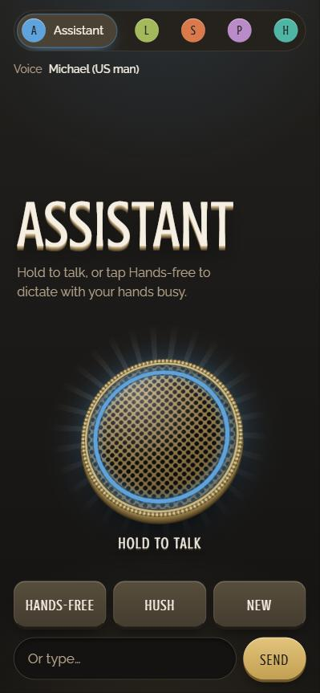
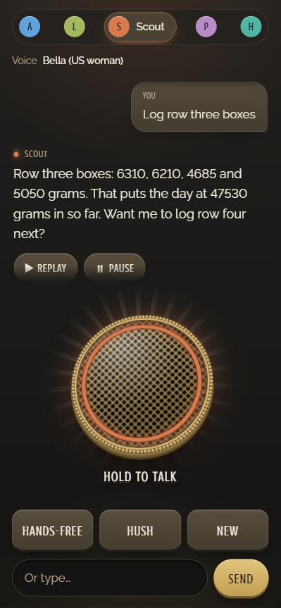

# Talk: a voice line to your Claude Code agents

Talk lets you speak to your Claude Code agents from your phone and hear them answer. Hold a button and talk, or switch
on hands-free and dictate for minutes at a time. The laptop writes down what you said, the agent answers in its own
home folder, and the phone reads the answer aloud in that agent's voice.

Everything runs on your Windows computer and on your Claude subscription. No API credits are used and no outside speech
service is involved: the speech-to-text and the voices are free programs that run locally.

<p>
  
  
</p>

The agents in the pictures are made up. The page shows whatever agents you list in your settings.

---

## Requirements

- Windows, with Python 3.11 or newer (`py -3`).
- [Claude Code](https://docs.claude.com/en/docs/claude-code) CLI, signed in with your Claude account.
- [Tailscale](https://tailscale.com/) on the computer and the phone, with `tailscale serve` available.
- `ffmpeg` on the PATH (used by the self-check).
- Python packages: `pip install faster-whisper kokoro-onnx numpy`
- Kokoro model files `kokoro-v1.0.onnx` and `voices-v1.0.bin`, downloaded from the kokoro-onnx GitHub releases into a
  `kokoro/` folder next to `talk_server.py`.

## Setup

1. Copy `settings.example.json` to `settings.json` and edit it (keys below). Put your Tailscale login in
   `allowed_logins` and your computer's tailnet name in `hosts`. `settings.json` is gitignored.
2. Put the two Kokoro files in `kokoro/`.
3. Run the self-check: `py -3 talk_server.py --check`. It ends with `check ok`.
4. Publish the server on your tailnet only:

   ```
   tailscale serve --bg --https=8443 http://127.0.0.1:2590
   ```

   (Use your own port if you changed `port`.)
5. Start it at logon with a scheduled task that runs `talk_server.cmd` (hidden), for example:

   ```powershell
   $a = New-ScheduledTaskAction -Execute "$PWD\talk_server.cmd"
   Register-ScheduledTask -TaskName 'Talk server' -Action $a -Trigger (New-ScheduledTaskTrigger -AtLogOn)
   ```

   If the packages were installed from inside the Claude desktop app, see the optional `PYTHONPATH` line in
   `talk_server.cmd`.
6. On the phone, with Tailscale on, open `https://<your-machine>.<your-tailnet>.ts.net:8443/` in Chrome.

### Settings

| Key | Meaning | Default |
|---|---|---|
| `allowed_logins` | Tailscale logins (emails) allowed to use the page. | none: nobody |
| `hosts` | The names the page is reached by: your computer's tailnet name, such as `my-laptop.my-tailnet.ts.net`. A request that arrives under any other name is refused. `127.0.0.1` and `localhost` always pass. | the two local names only |
| `port` | Local port the server listens on (127.0.0.1 only). | `2590` |
| `claude_path` | Path to the `claude` executable. | `claude` on the PATH, else `~/.local/bin/claude.exe` |
| `user_name` | How agents and the chat transcript refer to you. | `"the user"` |
| `keep_clips` | How many recent recordings to keep. | `30` |
| `chat_quiet_seconds` | Quiet time before a conversation is sent to the agent's desktop chat. | `600` |
| `vocabulary` | Hint text for Whisper: your jargon, names, units, and some example numbers. Whisper copies its style. | empty |
| `agents` | The agents on the line (below). | none |

Each agent has: `id` (short, no spaces), `name` (shown and spoken), `home` (the folder its `claude` session runs in, so
it loads that folder's instructions), `voice` (a Kokoro voice id such as `am_michael` or `af_heart`; `a`/`b` = American
/British, `f`/`m` = woman/man), `add_dirs` (extra folders it may work in), and optionally `agent` (the name of an agent
file to run instead of a plain home session).

## Using it

| Part | What it does |
|---|---|
| The row of agents | Tap one to pick who answers. The chosen one shows its name; each has its own colour, which the lamp ring on the microphone takes on. The phone remembers the last pick. |
| **Voice** drop-down | Picks the voice. "Phone:" voices are the phone's own; the rest are made on the laptop and are louder and clearer. |
| **Hold to talk** | Push-to-talk. Wait for the lamp ring and the screen to turn yellow, talk, let go. During hands-free it becomes **Tap to send**. |
| **Hands-free** | Starts a dictation: the mic stays open and every 10 seconds the new sound goes to the laptop, which writes it down while you keep talking. During one it becomes **Send**. |
| **Hush** | Stops the voice reading a reply. During hands-free it becomes **Pause** / **Resume**: pause stops recording and the timer without ending the dictation; Resume carries on in the same one. You can send while paused. |
| **New** | Starts a fresh voice conversation with this agent (anything waiting goes to its chat first). |
| Type box | For when you can't talk. Same as speaking. |

- Each reply bubble has **Replay** and **Pause** buttons. Pause stops mid-sentence and becomes **Resume**, which picks up
  exactly where it stopped.
- Replies start speaking a few seconds after you finish: the agent's words stream to the phone as it writes, and each
  sentence is spoken as soon as it is complete.
- The screen stays on while the page is open, because a locked phone stops a recording.
- If the connection drops mid-reply, the agent still finishes on the laptop. The page asks for the answer every 5
  seconds for up to 15 minutes, then shows and speaks it.
- Say numbers plainly; agents read them back so you can hear them. They are told to ask when a number seems missing.

## Conversations and the record

Each agent keeps one ongoing voice conversation (its session id is in `state.json`), separate from its chat in the
Claude desktop app. After `chat_quiet_seconds` of quiet, the server can send the conversation to that agent's desktop
chat, word for word. This feature depends on the Claude desktop app's `ListAgents` and `SendMessage` tools and is
optional: if the agent has no chat open, or those tools aren't available, nothing is lost, because `talk.log` keeps the
conversation and a failed send is retried after 30 minutes.

Two things keep the voice line and the app chat as one conversation:

- When you leave the page (another app, the lock screen), anything waiting is sent to the chats at once.
- Each voice turn starts with what was said in that agent's app chat since the last voice turn, read from the session
  files Claude Code keeps in `~/.claude/projects`. Tool output and the voice transcripts themselves are left out.

## How it works

```
phone (Chrome page)
  |  over Tailscale only; tailscale serve adds the caller's login
  v
tailscale serve :8443  -->  talk_server.py on 127.0.0.1:2590
                                 |- Whisper "small.en" (faster-whisper, local) writes down the speech
                                 |- claude -p, in the agent's home folder, on your subscription, answers
                                 '- Kokoro (local) turns the answer into speech, one sentence at a time
```

- **Speech to text:** Whisper `small.en` on the CPU, loaded once at start.
- **The agent:** `claude -p` in the agent's home folder, with `--resume` to continue the voice conversation. Voice turns
  run without connectors (MCP servers), which saves about 2 seconds. A note tells the agent it's a voice conversation:
  short spoken sentences, no tables or file paths, read numbers back, ask rather than guess. A turn is stopped after 15
  minutes.
- **Subscription only:** the server removes `ANTHROPIC_API_KEY` and `ANTHROPIC_AUTH_TOKEN` from the environment it gives
  `claude`, so a voice turn is billed to your subscription, never the API.
- **Speech:** Kokoro makes each chunk as a WAV file; the page plays it through a compressor with extra gain. Commas in
  numbers are removed first, because Kokoro reads "2,370" as "two, three seventy".
- **Keep-alive:** during long silent work the server sends a "still working" line every 15 seconds so the connection
  doesn't go idle.
- **Full speed:** run by Task Scheduler, Windows may put the process in efficiency mode (EcoQoS), which more than halved
  speech speed in testing. The server opts itself out at start.

### Guarding against made-up words

Whisper sometimes invents words on a quiet scrap of sound (a breath or a rustle), or repeats the words it was given as a
hint. The server asks Whisper how sure it is of each word and drops any line where the average is under 0.3. In testing,
made-up words scored 0.0 to 0.06 while real speech scored 0.76 or more. The same guard covers push-to-talk and
hands-free.

## Files

| File | What it is |
|---|---|
| `talk_server.py` | The server: page, speech-to-text, agents, voices, the record. |
| `index.html` | The phone page. Read fresh on every load, so page changes need only a reload. |
| `preview.py` | Shows the page in a desktop browser with made-up agents and replies. No Tailscale, microphone or agent needed. |
| `docs/` | The two pictures in this file. |
| `talk_server.cmd` | What the scheduled task runs. |
| `settings.example.json` | Template for your `settings.json`. |
| `kokoro/` | The voice model files (you download them; gitignored). |
| `clips/` | The last `keep_clips` recordings (gitignored). |
| `talk.log` | One line per turn: what was heard, the reply, timings, errors (gitignored). |
| `state.json` | Each agent's voice conversation and last chat send (gitignored). |
| `talk_server.log` | The server's own errors (gitignored). |

## Looking at the page without a phone

```
py -3 preview.py
```

Then open `http://127.0.0.1:2598/`. It serves the real `index.html` with five made-up agents and one canned reply, and a
hum in place of speech. Use it to change the look. It runs no agent and keeps nothing.

The page loads its two typefaces, Crushed and Raleway, from Google Fonts. That is the only request the page makes
outside your tailnet. Without it the page falls back to the phone's own typeface and still works.

## Self-check

```
py -3 talk_server.py --check
```

It tests reply stream parsing, the host-name check, catching up from the app chat (on a made-up session file), the
chat-send timing (with made-up agents "alpha" and "beta"), that each configured
agent's home folder exists and its voice exists, Whisper on numbers spoken by a Windows voice, the Kokoro voice reading
numbers back, and a 45-second dictation written down in 10-second pieces with no number lost or doubled. It ends with
`check ok`. With no agents configured, or with the example settings (whose folders don't exist), the agent check prints
a note and is skipped rather than failing; the speech tests still need ffmpeg and the Kokoro files.

## Troubleshooting

| What you see | What to check |
|---|---|
| Page won't open | Tailscale on, on phone and computer. Computer awake. Scheduled task running. `tailscale serve status`. |
| "not allowed" | The phone is signed in to Tailscale with a login that isn't in `allowed_logins`, or the address you opened isn't in `hosts`. `talk.log` has a "refused host" line with the name that was used. |
| Server exits at start | `settings.json` is missing or not valid JSON; see `talk_server.log`. |
| A word or number misheard | Its recording is in `clips/` (newest last). Add the word to `vocabulary`. |
| Words you never said | See "Guarding against made-up words". |
| Very quiet replies | Something else is holding the phone's mic. The page releases the mic after each recording for this reason. |
| "The laptop voice failed" | Pick a "Phone:" voice for now; check `talk_server.log` and the Kokoro files. |
| An agent "didn't answer" | Often the Claude CLI sign-in has run out. Sign in again. |
| Reply cut off | Wait: the page fetches the finished answer by itself for up to 15 minutes. |
| Imports fail only in the scheduled task | See the optional `PYTHONPATH` line in `talk_server.cmd`. |

## Security model

- The server listens on **127.0.0.1 only**. It is reachable from other devices only through `tailscale serve`, which
  publishes it on your private tailnet.
- Access is controlled by an allowlist of Tailscale logins. The server checks the `Tailscale-User-Login` header that
  `tailscale serve` adds to each request. **Never expose the port directly, and never use Tailscale Funnel or any other
  public proxy for it:** the header could then be forged by anyone, and the allowlist would mean nothing.
- The server also checks the name each request arrived under (the `Host` header) against `hosts`. A web page that
  tricks your browser into calling `127.0.0.1` arrives under its own site's name and is refused.
- **Known limit:** a program already running on the same computer can connect to the port and write that login header
  itself. Such a program can already run `claude` as you, so the server does not try to stop it. Don't run Talk on a
  computer you share with people or programs you don't trust.
- Agents run with `--permission-mode auto` in their home folders. **Anyone on the allowlist can make the agents act**
  (read and change files, run commands) as your user. Allow only logins you trust as much as your own keyboard.
- Recordings (`clips/`), transcripts (`talk.log`) and conversation ids (`state.json`) stay on your computer. Keep this
  folder out of cloud-synced locations if the talk is private.
- The API key is stripped from the environment of every `claude` run, so usage is on your subscription, not metered API
  billing.
- No outside speech service is used; Whisper and Kokoro run locally.

## License

MIT. See `LICENSE`.
